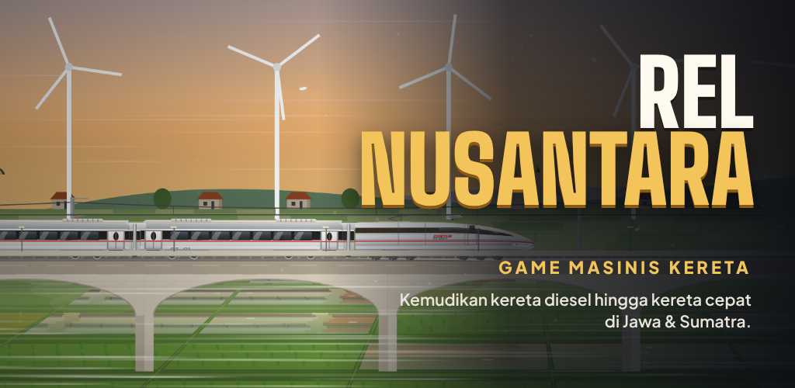
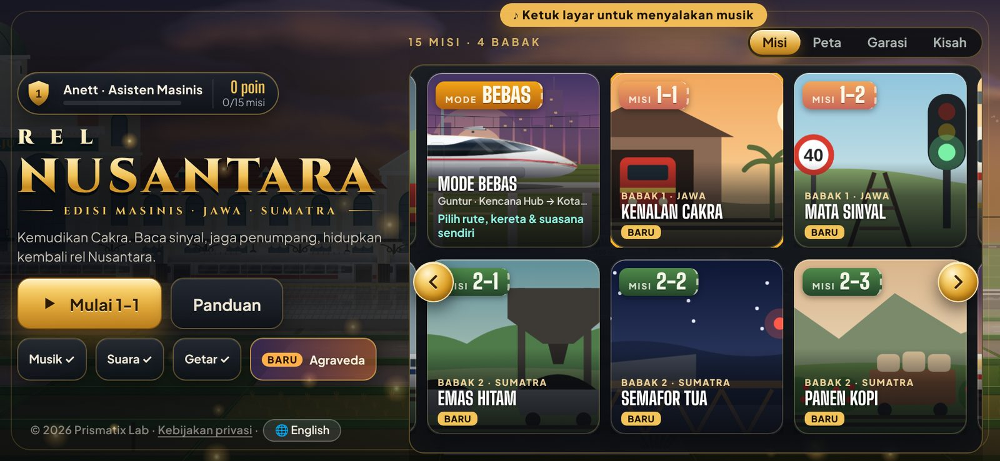
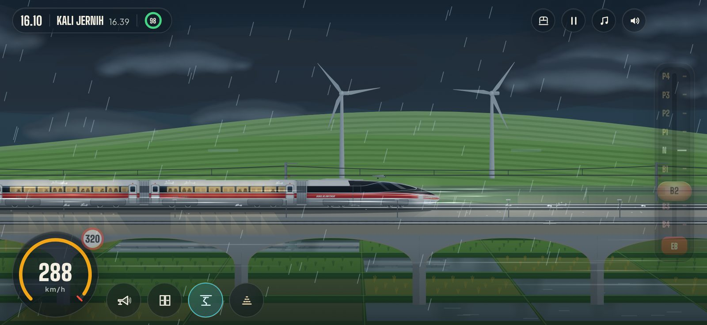
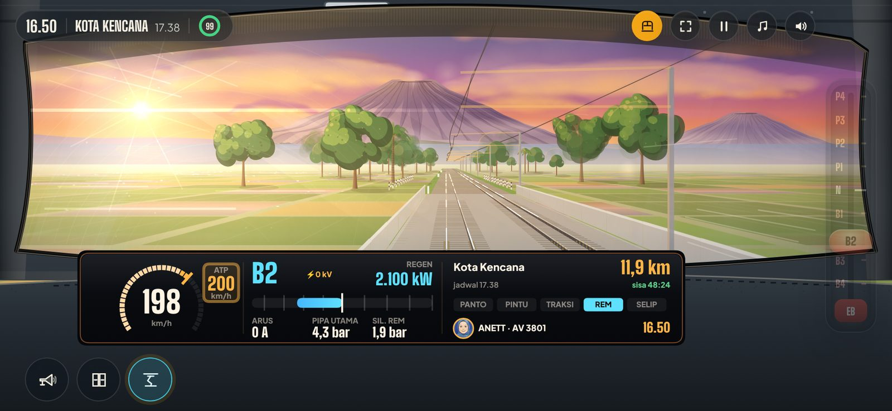
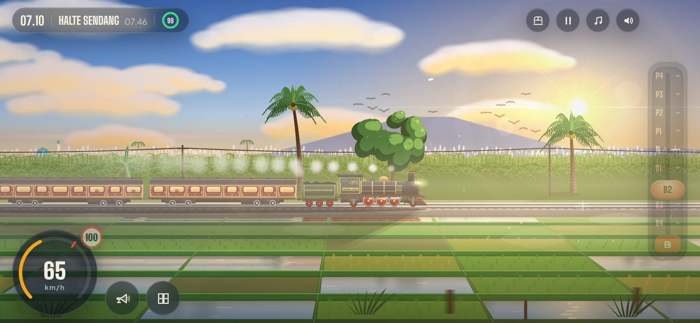
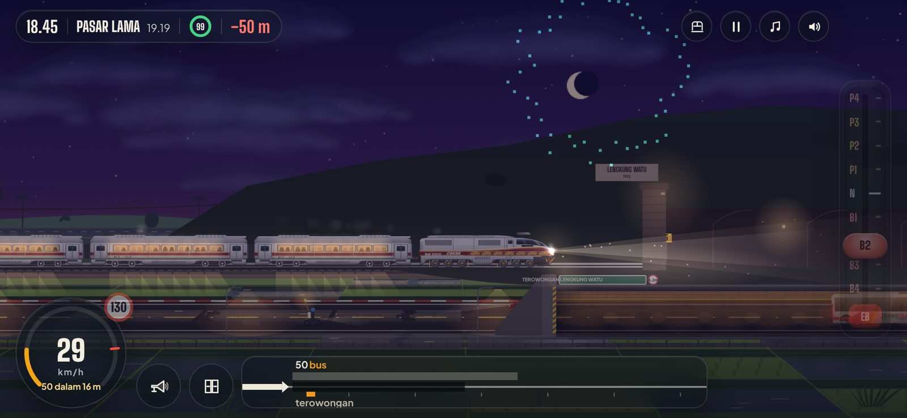
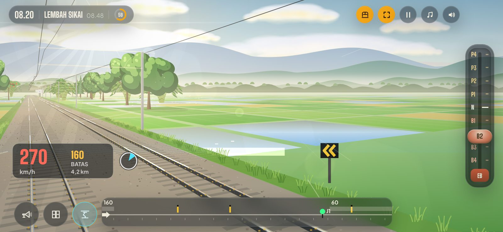
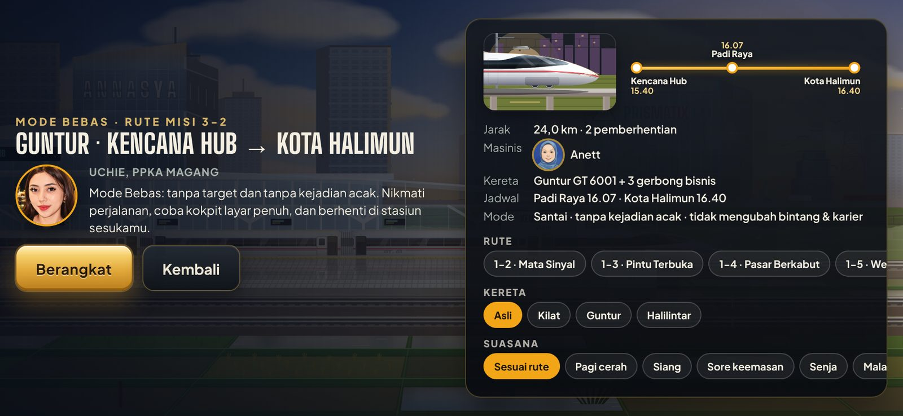

<div align="center">



# Rel Nusantara · Edisi Masinis

**Game simulasi masinis kereta api di Jawa & Sumatra, langsung dari peramban HP.**

Bawa Cakra si lokomotif diesel, Argo Senja bertenaga listrik, kereta cepat Guntur & Halilintar hingga **320 km/h**,
sampai lokomotif uap Surya 1912. Baca sinyal, jaga kenyamanan penumpang, berhenti tepat di marka, dan hidupkan kembali rel Nusantara.

### [▶ Main sekarang di syannuri.github.io/meds-game](https://syannuri.github.io/meds-game/)

`15 misi` · `4 babak` · `6 kereta` · `2 pulau` · `Bahasa Indonesia & English` · `iPhone · iPad · Android · Desktop`

</div>

---

## Cuplikan

<table>
  <tr>
    <td width="50%"><br><sub><b>Menu utama</b>: karcis misi bergaya karcis kereta lama, Mode Bebas, peta, garasi & kisah kru</sub></td>
    <td width="50%"><br><sub><b>Kokpit layar penuh</b>: Guntur melaju 288 km/h di jalur layang saat sore keemasan</sub></td>
  </tr>
  <tr>
    <td><br><sub><b>Halilintar</b> menembus badai di viaduk Lengkung Watu, rel basah & angin samping</sub></td>
    <td><br><sub><b>Argo Senja</b>: kabin kereta listrik dengan dasbor digital, senja di Kota Kencana</sub></td>
  </tr>
  <tr>
    <td><br><sub><b>Surya 1912</b>: lokomotif uap warisan mengepul di lereng Sela</sub></td>
    <td><br><sub><b>Pagi berkabut</b> di Cibening, lengkap dengan kartu pos landmark yang bisa dikoleksi</sub></td>
  </tr>
  <tr>
    <td><br><sub><b>Duel Malam Takbiran</b>: balapan dengan bus TransKilat menuju terowongan Lengkung Watu</sub></td>
    <td><br><sub>Kembang api, terowongan kereta & terowongan jalan raya bus di malam Lebaran</sub></td>
  </tr>
  <tr>
    <td><br><sub><b>Menoleh</b> ke kiri/kanan dari kokpit dengan geser layar atau memutar ponsel (giroskop)</sub></td>
    <td><br><sub><b>Mode Bebas</b>: pilih rute, kereta & suasana sendiri tanpa target</sub></td>
  </tr>
</table>

## Fitur utama

- **Kendali masinis sungguhan**: tuas P1–P4 / N / B1–B4 / EB, rem bertahap, meluncur, rem darurat, pasir untuk rel licin, pantograf untuk kereta listrik, klakson, dan pintu penumpang.
- **Fisika kereta**: massa rangkaian, tanjakan & turunan, roda selip saat hujan, jarak pengereman yang terasa makin panjang di kecepatan tinggi, dan sentakan yang mengurangi kenyamanan.
- **Sinyal & aturan jalan**: sinyal blok tiga warna, sinyal semafor tua, batas kecepatan, papan REM, wesel, persilangan di lintas tunggal, perbaikan rel, dan gangguan sinyal acak.
- **Dua sudut pandang**: tampak samping 2.5D yang sinematik, atau **kokpit** dengan dasbor tiap kereta, kokpit **layar penuh**, dan **menoleh** kiri/kanan (geser layar atau giroskop).
- **Dunia yang hidup**: sawah berpetak, kebun sawit Sumatra, gunung berlapis, jalur layang & ngarai, terowongan, jembatan, stasiun megah, penumpang yang naik-turun, gajah Sumatra, kambing di rel, bus pesaing, kembang api malam takbiran.
- **Cuaca & waktu**: fajar, siang, sore keemasan, senja, malam, kabut, hujan, hingga badai yang mereda di tengah perjalanan.
- **Cerita & karier**: kisah kru yang berlanjut antarmisi, dilema dengan akibat, penumpang tetap yang mengingat kamu, pangkat masinis, sertifikasi lokomotif, medali tantangan, livery spesial, dan album kartu pos.
- **Rute Harian** dengan kondisi acak setiap hari dan **Mode Bebas** untuk menikmati pemandangan.
- **Rekaman bayangan (ghost run)** perjalanan terbaikmu, laporan perjalanan lengkap dengan grafik kecepatan, dan mode **Masinis Ahli** tanpa bantuan HUD.
- **Audio dinamis**: deru mesin, derak rel & wesel, klakson khas tiap kereta, pengumuman stasiun, dan musik adaptif.
- **Ringan & tanpa instalasi**: HTML5 Canvas + JavaScript murni, grafis adaptif otomatis, bisa dipasang ke layar utama iPhone/iPad/Android.

## Kereta

| Kereta | Jenis | Kecepatan | Dipakai di |
|---|---|---|---|
| **Cakra** RN 2001 | Lokomotif diesel-elektrik | hingga 150 km/h | Babak 1 & 2 |
| **Argo Senja** (Agraveda AV 3801) | Kereta listrik 25 kV | 200 km/h | Misi 3-1 |
| **Kilat G1** | Kereta cepat generasi pertama | 200 km/h | Misi 3-3 |
| **Guntur** | Kereta cepat | 250 km/h | Misi 3-2 |
| **Halilintar** | Kereta super cepat | 320 km/h | Misi 3-4 |
| **Surya 1912** | Lokomotif uap warisan | 100 km/h | Misi 4-1 |

## Misi

| Misi | Judul | Rute | Tantangan |
|---|---|---|---|
| 1-1 | Langkah Pertama di Depo | Depo Sukamaju → Sukamaju | Mengenal tuas & berhenti di marka |
| 1-2 | Membaca Sinyal | Sukamaju → Kali Kecil → Cibening | Sinyal & batas kecepatan |
| 1-3 | Penumpang Pertama | Sukamaju → Sumberrejo → Cibening | Pintu, kenyamanan, klakson di perlintasan |
| 1-4 | Pagi Pertama Pasar Minggu | Sukamaju → Cibening → Pasar Lama | Kabut, perlintasan, kambing |
| 1-5 | Hujan di Lengkung Watu | Pasar Lama → Kali Jernih → Watugede | Hujan & petir, terowongan, wesel |
| 1-6 | Duel Malam Takbiran | Watugede → Pasar Lama → Sukamaju | Balapan bus, kereta penuh pemudik |
| 1-7 | Bersilang di Krajan | Watugede → Krajan → Kedung Banteng | Persilangan lintas tunggal, pohon tumbang, banjir |
| 2-1 | Emas Hitam | Tambang Muara Kelam → Dermaga Tanjung Api | Kereta batu bara, muat presisi, gajah |
| 2-2 | Jalur yang Ditutup | Muara Kelam → Lubuk Tua → Simpang Barisan | Malam gelap, semafor, jembatan kayu |
| 2-3 | Kereta Rakyat | Simpang Barisan → Pasar Kopi Liwa → Muara Kelam | Menyambung gerbong kopi di hari pasar |
| 3-1 | Argo Senja | Sukamaju → Kota Kencana | Ekspres listrik 200 km/h saat senja |
| 3-2 | Guntur di Atas Sawah | Kencana Hub → Padi Raya → Kota Halimun | Kereta cepat 250 km/h di jalur layang |
| 3-3 | Kilat di Bukit Barisan | Muara Kelam Baru → Lembah Sikai → Kota Barisan | Ngarai, terowongan, kabut pegunungan |
| 3-4 | Badai di Lengkung Watu | Pasar Lama → … → Tanjung Surya | 320 km/h di tengah badai, sabotase wesel |
| 4-1 | Uap Pagi di Lereng Sela | Museum Watugede → Halte Sendang → Bukit Kopen | Lokomotif uap, tanjakan, isi air |

## Cara bermain

1. Buka **[syannuri.github.io/meds-game](https://syannuri.github.io/meds-game/)** dan putar HP ke posisi **mendatar**.
2. Pilih misi, baca briefing, lalu tutup pintu dan geser tuas ke **P1–P4** untuk berangkat.
3. Patuhi sinyal & batas kecepatan, lalu mulai **rem B1–B4** lebih awal agar berhenti tepat di marka.
4. Raih tiga bintang dari tepat waktu, kenyamanan, dan berhenti presisi.

**Pasang seperti aplikasi:**
- **iPhone / iPad**: buka di Safari → tombol Bagikan → **Tambah ke Layar Utama**.
- **Android**: buka di Chrome → menu ⋮ → **Instal aplikasi**.

**Keyboard (desktop):** `↑/W` tenaga · `↓/S` rem · `Spasi` rem darurat · `H` klakson · `D/Enter` pintu · `A` pasir · `V` ganti tampilan · `Esc` jeda.

## Untuk pengembang

```bash
cd app
npm run serve   # http://localhost:8080
npm test        # uji asap semua misi (Playwright)
```

- Kode game: [`app/www`](app/www) (`index.html`, `game.js`, `style.css`, `i18n.js`), tanpa dependensi.
- Rancangan game: [`docs/GAME_DESIGN.md`](docs/GAME_DESIGN.md) · catatan teknis lengkap: [`app/README.md`](app/README.md).
- Aplikasi Android/iOS dibungkus **Capacitor**; panduan rilis Google Play: [`docs/PLAY_STORE.md`](docs/PLAY_STORE.md).
- Setiap perubahan di `main` diuji otomatis dan diterbitkan ke GitHub Pages.

## Hak cipta

© 2026 Prismatix Lab. Semua hak dilindungi. Lihat [LICENSE](LICENSE).

Semua kereta, livery, operator, stasiun, dan tokoh dalam game ini fiktif.
