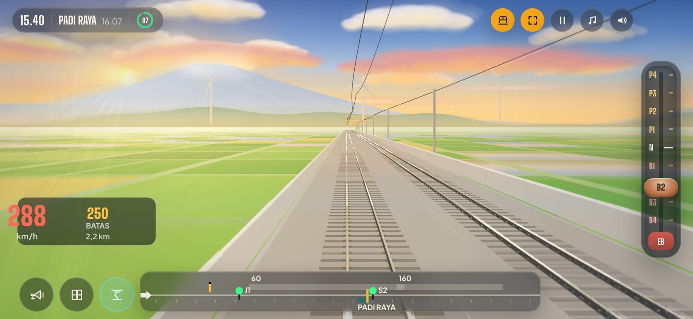
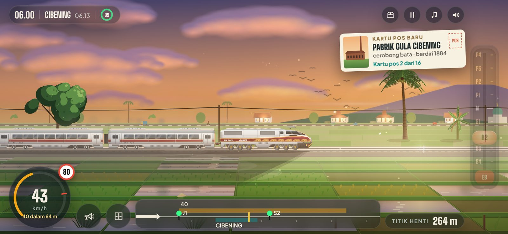
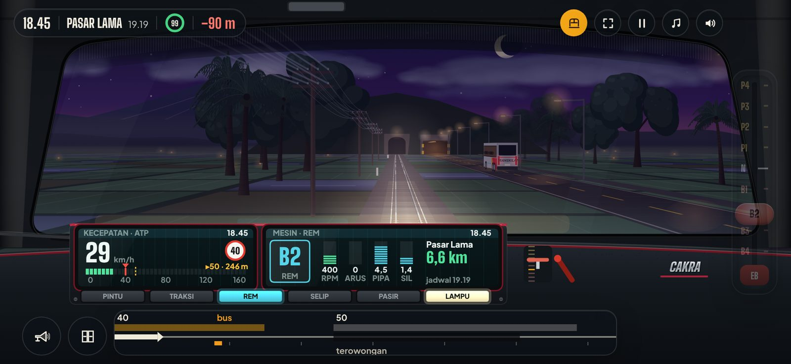

<div align="center">


# Rel Nusantara · Driver's Edition

**A train driver simulator set across Java & Sumatra, playable right in your phone's browser.**

Drive Cakra the diesel locomotive, the electric Argo Senja, the Guntur and Halilintar high-speed trains at up to **320 km/h**,
and even the Surya 1912 steam engine. Read the signals, keep your passengers comfortable, stop right on the mark, and bring the Nusantara railway back to life.

### [▶ Play now at syannuri.github.io/meds-game](https://syannuri.github.io/meds-game/)

`15 missions` · `4 chapters` · `6 trains` · `2 islands` · `Indonesian & English` · `iPhone · iPad · Android · Desktop`

</div>

---

## Screenshots

<table>
  <tr>
    <td width="50%"><br><sub><b>Main menu</b>: mission cards styled like vintage train tickets, Free Mode, map, garage & crew stories</sub></td>
    <td width="50%"><br><sub><b>Full-screen cab</b>: Guntur racing at 288 km/h along an elevated line on a golden afternoon</sub></td>
  </tr>
  <tr>
    <td><br><sub><b>Halilintar</b> pushing through a storm on the Lengkung Watu viaduct, with wet rails and crosswinds</sub></td>
    <td><br><sub><b>Argo Senja</b>: electric train cab with a digital dashboard, at dusk near Kota Kencana</sub></td>
  </tr>
  <tr>
    <td><br><sub><b>Surya 1912</b>: a heritage steam locomotive puffing up the Sela slopes</sub></td>
    <td><br><sub><b>Misty morning</b> at Cibening, with collectible landmark postcards</sub></td>
  </tr>
  <tr>
    <td><br><sub><b>Takbiran Night Duel</b>: racing the TransKilat bus toward the Lengkung Watu tunnels</sub></td>
    <td><br><sub>Fireworks, the rail tunnel and the bus road tunnel on Eid eve</sub></td>
  </tr>
  <tr>
    <td><br><sub><b>Look around</b> from the cab by dragging the screen or turning your phone (gyroscope)</sub></td>
    <td><br><sub><b>Free Mode</b>: pick your own route, train and atmosphere, with no objectives</sub></td>
  </tr>
</table>

## Key features

- **Real driver controls**: P1–P4 / N / B1–B4 / EB master controller, graduated braking, coasting, emergency brake, sand for slippery rails, pantograph for electric trains, horn and passenger doors.
- **Train physics**: train mass, gradients, wheel slip in the rain, braking distances that grow at high speed, and jerks that cost passenger comfort.
- **Signals & rules of the line**: three-aspect block signals, old semaphores, speed limits, BRAKE boards, turnouts, crossings on single track, track works and random signal faults.
- **Two viewpoints**: a cinematic 2.5D side view, or the **cab view** with a dashboard for each train, a **full-screen cab**, and **looking left/right** (drag the screen or use the gyroscope).
- **A living world**: patchwork rice fields, Sumatran oil-palm estates, layered mountains, elevated lines and gorges, tunnels, bridges, grand stations, boarding passengers, Sumatran elephants, goats on the track, a rival bus, and Eid eve fireworks.
- **Weather & time of day**: dawn, midday, golden afternoon, dusk, night, fog, rain, and storms that clear mid-journey.
- **Story & career**: crew stories that continue across missions, choices with consequences, regular passengers who remember you, driver ranks, locomotive certifications, challenge medals, special liveries and a postcard album.
- **Daily Route** with new random conditions every day, and **Free Mode** for enjoying the scenery.
- **Ghost runs** of your best trip, a full trip report with a speed graph, and an **Expert Driver** mode without HUD assists.
- **Dynamic audio**: engine roar, rail and turnout clatter, a distinct horn for each train, station announcements and adaptive music.
- **Lightweight, nothing to install**: pure HTML5 Canvas + JavaScript, automatic adaptive graphics, and it can be added to the home screen on iPhone, iPad and Android.

## Trains

| Train | Type | Top speed | Used in |
|---|---|---|---|
| **Cakra** RN 2001 | Diesel-electric locomotive | up to 150 km/h | Chapters 1 & 2 |
| **Argo Senja** (Agraveda AV 3801) | 25 kV electric train | 200 km/h | Mission 3-1 |
| **Kilat G1** | First-generation high-speed train | 200 km/h | Mission 3-3 |
| **Guntur** | High-speed train | 250 km/h | Mission 3-2 |
| **Halilintar** | Very high-speed train | 320 km/h | Mission 3-4 |
| **Surya 1912** | Heritage steam locomotive | 100 km/h | Mission 4-1 |

## Missions

| Mission | Title | Route | Challenge |
|---|---|---|---|
| 1-1 | First Steps at the Depot | Sukamaju Depot → Sukamaju | Learn the controller and stop on the mark |
| 1-2 | Reading Signals | Sukamaju → Kali Kecil → Cibening | Signals and speed limits |
| 1-3 | First Passengers | Sukamaju → Sumberrejo → Cibening | Doors, comfort, horn at level crossings |
| 1-4 | First Sunday Market Morning | Sukamaju → Cibening → Pasar Lama | Fog, level crossings, goats |
| 1-5 | Rain at Lengkung Watu | Pasar Lama → Kali Jernih → Watugede | Rain and lightning, tunnel, turnout |
| 1-6 | Takbiran Night Duel | Watugede → Pasar Lama → Sukamaju | Race the bus with a train full of homecoming travellers |
| 1-7 | Crossing at Krajan | Watugede → Krajan → Kedung Banteng | Single-track crossing, fallen tree, flooding |
| 2-1 | Black Gold | Muara Kelam Mine → Tanjung Api Wharf | Coal train, precision loading, elephants |
| 2-2 | The Closed Line | Muara Kelam → Lubuk Tua → Simpang Barisan | Dark night, semaphores, wooden bridge |
| 2-3 | The People's Train | Simpang Barisan → Pasar Kopi Liwa → Muara Kelam | Coupling the coffee wagon on market day |
| 3-1 | Argo Senja | Sukamaju → Kota Kencana | 200 km/h electric express at dusk |
| 3-2 | Guntur over the Rice Fields | Kencana Hub → Padi Raya → Kota Halimun | 250 km/h high-speed train on an elevated line |
| 3-3 | Kilat in the Bukit Barisan | Muara Kelam Baru → Lembah Sikai → Kota Barisan | Gorges, tunnels, mountain fog |
| 3-4 | Storm at Lengkung Watu | Pasar Lama → … → Tanjung Surya | 320 km/h through a storm, sabotaged turnout |
| 4-1 | Morning Steam on Mount Sela | Watugede Museum → Sendang Halt → Bukit Kopen | Steam locomotive, climbs, taking on water |

## How to play

1. Open **[syannuri.github.io/meds-game](https://syannuri.github.io/meds-game/)** and turn your phone to **landscape**.
2. Pick a mission, read the briefing, then close the doors and move the controller to **P1–P4** to depart.
3. Obey signals and speed limits, and start braking with **B1–B4** early so you stop right on the mark.
4. Earn three stars for punctuality, comfort and precise stops.

**Install it like an app:**
- **iPhone / iPad**: open it in Safari → Share button → **Add to Home Screen**.
- **Android**: open it in Chrome → ⋮ menu → **Install app**.

**Keyboard (desktop):** `↑/W` power · `↓/S` brake · `Space` emergency brake · `H` horn · `D/Enter` doors · `A` sand · `V` switch view · `Esc` pause.

## For developers

```bash
cd app
npm run serve   # http://localhost:8080
npm test        # smoke test of every mission (Playwright)
```

- Game code: [`app/www`](app/www) (`index.html`, `game.js`, `style.css`, `i18n.js`), with no dependencies.
- Game design: [`docs/GAME_DESIGN.md`](docs/GAME_DESIGN.md) · full technical notes: [`app/README.md`](app/README.md).
- The Android/iOS apps are wrapped with **Capacitor**; Google Play release guide: [`docs/PLAY_STORE.md`](docs/PLAY_STORE.md).
- Every change on `main` is tested automatically and published to GitHub Pages.

## Copyright

© 2026 Prismatix Lab. All rights reserved. See [LICENSE](LICENSE).

All trains, liveries, operators, stations and characters in this game are fictional.
